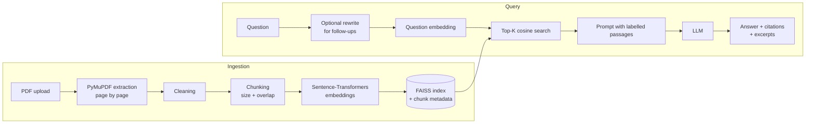

# RAG-Based Research Paper Assistant

Upload research papers (PDF), ask questions in plain English, and get answers that are grounded **only** in the papers, with the document name, page number and the supporting excerpt for every source.

## Problem statement

Skimming several papers to find a method, dataset or limitation is slow, and general chatbots answer from memory and can invent details. This project retrieves the relevant passages from your own papers first, then asks an LLM to answer strictly from those passages and cite them. If the papers do not contain the answer, it says so.

## Features

- Multi-PDF upload; chunks keep `document_name`, `page_number`, `chunk_id` and text
- Page-aware extraction (PyMuPDF), cleaning (de-hyphenation, whitespace, ligatures) and overlapping, word-safe chunking
- Local sentence-transformers embeddings (`all-MiniLM-L6-v2`, swappable behind an `Embedder` interface)
- Persistent FAISS index (survives restarts) with per-document deletion
- Cross-paper retrieval, optional per-paper filtering, similarity threshold
- Strict RAG prompt, citations (`[file.pdf, p. 4]`), excerpts, explicit "not enough information" answer
- Lightweight follow-up support: the follow-up is rewritten into a standalone question before retrieval, and chat history is never used as evidence
- Duplicate uploads are detected by SHA-256 and not re-embedded
- Upload validation (extension, `%PDF-` signature, size limit, sanitised filenames), friendly errors, no stack traces to clients
- Responsive web UI, Dockerfile, tests, and a small evaluation script

## Architecture



| Layer | File |
|---|---|
| API | `app/api/documents.py`, `query.py`, `health.py`, `app/main.py` |
| PDF processing | `app/services/pdf_processor.py` |
| Chunking | `app/services/chunker.py` |
| Embeddings | `app/services/embeddings.py` |
| Vector store | `app/services/vector_store.py` (+ `document_registry.py` for document metadata) |
| Retrieval | `app/services/retriever.py` |
| LLM + prompts | `app/services/llm_service.py` |
| Orchestration | `app/services/rag_pipeline.py`, `container.py` |
| Config / errors | `app/core/` |

## Tech stack

Python, FastAPI, Uvicorn, Pydantic, PyMuPDF, sentence-transformers, FAISS (`faiss-cpu`), OpenAI-compatible LLM API (`openai` SDK), plain HTML/CSS/JS, pytest, Docker.

## Project structure

```
rag-research-paper-assistant/
├── app/
│   ├── main.py                  # app factory, error handlers, static frontend
│   ├── api/                     # documents, query, health, deps
│   ├── core/                    # config, exceptions, logging
│   ├── models/                  # schemas.py (API), domain.py (internal)
│   ├── services/                # pdf, chunker, embeddings, vector store, retriever, llm, pipeline
│   └── utils/                   # filename/upload validation, excerpts
├── frontend/                    # index.html, style.css, app.js
├── evaluation/                  # eval dataset, synthetic sample paper, run_eval.py
├── tests/
├── data/{uploads,index}/        # created at runtime (git-ignored)
├── .env.example  requirements.txt  requirements-dev.txt
└── Dockerfile  docker-compose.yml
```

## How RAG works here

1. **Ingest.** Each PDF page is extracted and cleaned. Every page is split into ~1000-character chunks with ~150 characters of overlap, cut at sentence or word boundaries. Chunking is per page so each chunk has an exact page number.
2. **Embed.** Chunks are embedded in batches by `all-MiniLM-L6-v2` (384 dimensions) and L2-normalised, so inner product equals cosine similarity.
3. **Index.** Vectors go into a FAISS `IndexFlatIP` wrapped in `IndexIDMap2` (exact search, deletable by id). Chunk metadata is stored in `chunks.json` next to the index; both files are written atomically.
4. **Retrieve.** The question is embedded with the same model and the top-K most similar chunks (across all selected papers) are fetched. Chunks below `MIN_SIMILARITY` are dropped; if nothing is left the LLM is not called.
5. **Generate.** The prompt contains the labelled passages (`[Passage 2 | paper.pdf, p. 4]`) and strict rules: use only the passages, cite `[file, p. N]`, keep papers separate, refuse with a fixed sentence if unsupported, and treat passage text as data, not instructions.
6. **Return.** The API returns the answer, a flag `answer_found`, and sources with document, page, similarity score and excerpt.

## Installation and running locally

Requires Python 3.10+ (3.11 recommended).

```bash
python -m venv .venv
source .venv/bin/activate            # Windows: .venv\Scripts\activate
pip install -r requirements.txt
cp .env.example .env                 # Windows: copy .env.example .env
# edit .env and set OPENAI_API_KEY=...
uvicorn app.main:create_app --factory --reload --port 8000
```

Open <http://localhost:8000> (UI) or <http://localhost:8000/docs> (interactive API docs). The first upload downloads the embedding model (about 90 MB) once.

## Environment variables

| Variable | Default | Purpose |
|---|---|---|
| `OPENAI_API_KEY` | (empty) | **Required to answer questions.** Never commit `.env`. |
| `LLM_MODEL` | `gpt-4o-mini` | Any chat model your provider offers |
| `LLM_BASE_URL` | (empty) | Use another OpenAI-compatible server (Ollama, vLLM, Groq, ...) |
| `LLM_TEMPERATURE` / `LLM_MAX_TOKENS` | `0.1` / `700` | Generation settings |
| `EMBEDDING_MODEL` | `sentence-transformers/all-MiniLM-L6-v2` | If you change it, delete `data/index` and re-upload |
| `CHUNK_SIZE` / `CHUNK_OVERLAP` | `1000` / `150` | Characters |
| `TOP_K` | `5` | Chunks sent to the LLM |
| `MIN_SIMILARITY` | `0.15` | Minimum cosine similarity (untuned default) |
| `MAX_FILE_SIZE_MB` | `25` | Upload limit |
| `DATA_DIR` | `./data` | Where PDFs and the index live |

Using a local server such as Ollama: set `LLM_BASE_URL=http://localhost:11434/v1`, `LLM_MODEL=<your model>`; no API key is needed.

## Docker

```bash
cp .env.example .env     # set OPENAI_API_KEY
docker compose up --build
```

The app is at <http://localhost:8000>; `./data` is mounted so papers and the index persist.

## API

| Method | Path | Description |
|---|---|---|
| POST | `/api/documents/upload` | multipart field `file` (PDF). 201 new, 200 if already indexed |
| GET | `/api/documents` | indexed documents and totals |
| DELETE | `/api/documents/{document_id}` | removes the document, its vectors and stored file |
| POST | `/api/query` | `{question, top_k?, document_ids?, history?}` |
| GET | `/api/health` | counts, model names, whether an LLM key is configured |

Errors: `413` too large, `415` not a PDF, `422` unreadable / no extractable text / invalid question, `404` unknown document, `409` no documents indexed, `502` LLM provider error, `503` missing API key. Body is always `{"detail": "..."}`.

```bash
curl -F "file=@paper.pdf" http://localhost:8000/api/documents/upload
curl -X POST http://localhost:8000/api/query -H "Content-Type: application/json" \
     -d '{"question": "What methodology does the paper propose?"}'
```

## Example questions

- What methodology does the paper propose?
- Which datasets were used for evaluation?
- How do the two papers differ in their experimental setup?
- What limitations do the authors mention?

## Example response

```json
{
  "answer": "The paper proposes LeafNet, a lightweight CNN built from depthwise separable convolutions and a channel attention module [sample_paper.pdf, p. 1].",
  "answer_found": true,
  "standalone_question": "What method does the paper propose?",
  "sources": [
    {"index": 1, "document_name": "sample_paper.pdf", "page_number": 1, "chunk_id": "a1b2c3-p1-c0",
     "score": 0.61, "excerpt": "Abstract. Plant diseases reduce crop yields ... We propose LeafNet, a lightweight ..."}
  ],
  "timings_ms": {"rewrite": 0.0, "retrieval": 12.4, "generation": 950.1}
}
```
(Illustrative shape only; the values are not measured results.)

## Testing and evaluation

```bash
pip install -r requirements-dev.txt
pytest
python -m evaluation.run_eval               # retrieval metrics on a synthetic paper, no API key
python -m evaluation.run_eval --with-llm    # also heuristic answer checks (uses your API key)
```

Tests use a deterministic hashing embedder and a fake LLM, so they need no downloads or API calls. Tests that need PyMuPDF, FAISS or FastAPI skip automatically if those packages are missing. The evaluation reports page hit@k, keyword hit@k and MRR; with `--with-llm` it adds keyword presence, a lexical groundedness proxy, citation validity and refusal accuracy. The dataset is tiny and synthetic, so treat the numbers as regression signals, not benchmarks.

## Limitations

- No OCR: scanned PDFs are rejected with a clear message.
- Two-column layouts, tables, equations and figures are extracted as plain text and may be out of order or garbled.
- Chunks do not cross page boundaries, so a sentence spanning two pages is split.
- `IndexFlatIP` is exact but scans every vector; fine for hundreds of papers, not millions of chunks.
- Single-process app with file-based storage and no authentication or per-user isolation.
- The LLM can still misquote or misread a passage; citations let the user verify but do not guarantee correctness. Answer-found detection relies on the model using the exact refusal sentence.
- `MIN_SIMILARITY` and `CHUNK_SIZE` have sensible defaults but have not been tuned on a real corpus.
- Follow-up rewriting costs one extra LLM call.

## Future improvements

Hybrid search (BM25 + dense), cross-encoder re-ranking, section-aware chunking, OCR, streaming answers, `IndexIVF`/HNSW for scale, authentication and per-user indexes, larger evaluation sets with human labels, response caching.

## Resume-ready description

**RAG-Based Research Paper Assistant** (Python, FastAPI, FAISS, sentence-transformers, PyMuPDF)
- Built an end-to-end retrieval-augmented generation app that answers questions across multiple uploaded research papers, returning page-level citations and excerpts for each answer.
- Implemented a page-aware ingestion pipeline (PDF extraction, cleaning, overlapping chunking, batched MiniLM embeddings) feeding a persistent FAISS index with per-document deletion and duplicate detection.
- Designed a grounded-generation prompt and fallback logic so the assistant refuses when retrieved evidence is insufficient; added follow-up question rewriting that keeps retrieval, not chat history, as the source of truth.
- Delivered a REST API with validation and structured errors, a responsive web UI, Docker support, a pytest suite and a retrieval/groundedness evaluation script.
